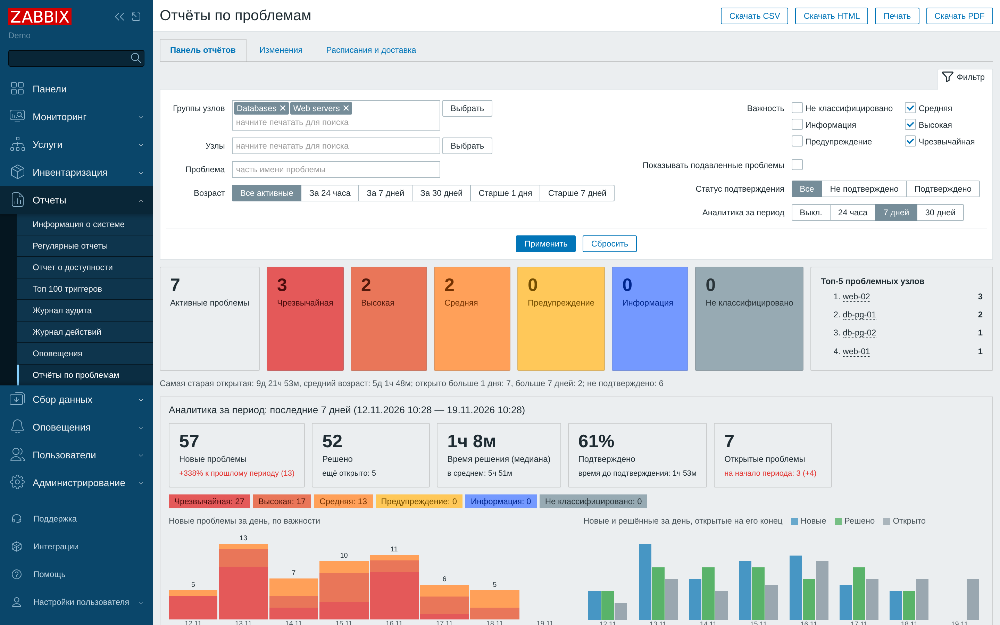
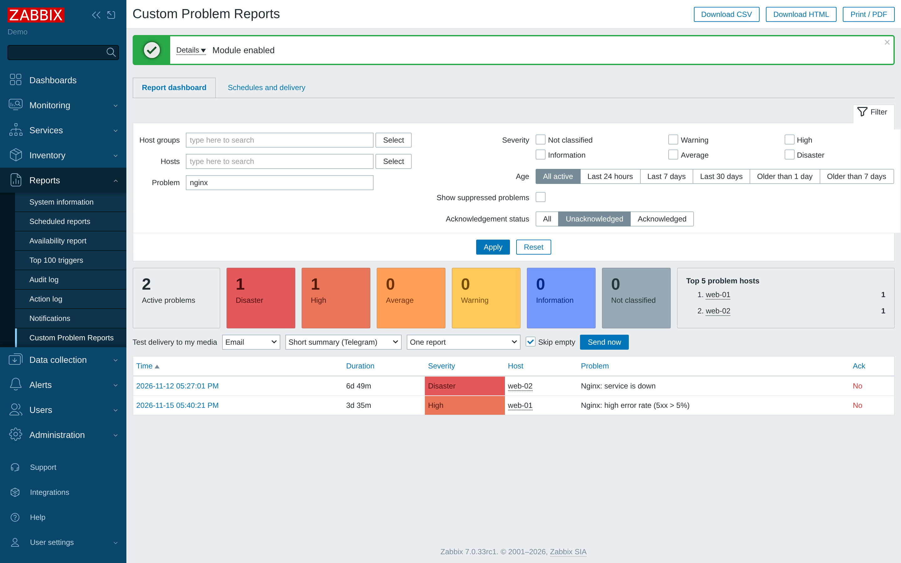
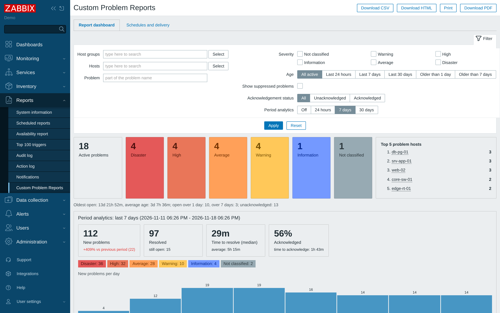

# Custom Problem Reports: модуль Zabbix 7.0 LTS

Модуль фронтенда (manifest v2.0) добавляет пункт **Reports → Custom Problem Reports**:

- **Вкладка «Report dashboard»**: фильтр (группы хостов, хосты, важность, возраст проблемы), KPI-карточки
  (всего активных проблем, разбивка по важности в цветах Zabbix, топ-5 хостов), таблица незакрытых проблем
  (время, длительность, важность, хост, проблема, подтверждение), выгрузка CSV / HTML / PDF / печать
  и тестовая отправка «Send now» на свои media.
- **Вкладка «Schedules and delivery»** (только Super admin): расписания рассылок (ежедневно или еженедельно
  в заданный день и время), фильтр отчёта, получатели (пользователи, группы пользователей, дополнительные адреса),
  media type (Email, Telegram webhook, Script), формат (краткая сводка, подробный HTML, CSV),
  разбивка: одним отчётом, **отдельно по группам хостов** или **отдельно по хостам**, опция «не отправлять пустые».
  Там же блок **Cron job**: статус рассыльщика и кнопка создания/удаления задания cron.
- **`bin/send_reports.php`**: CLI-рассыльщик для cron (раз в минуту).

## Скриншоты

Сняты на Zabbix 7.0.33 с тестовыми данными.

| | |
|---|---|
|  |  |
| Дашборд: KPI, топ хостов, тестовая отправка, таблица проблем | Фильтр: группы Databases + Web servers, Average и выше |
|  |  |
| Расписания и блок Cron job | Выгрузка HTML (то же уходит в письме) |
|  |  |
| Форма расписания: разбивка по хостам, свои получатели | Разбивка по группам хостов, свои получатели |
|  |  |
| Фильтр «nginx» + неподтверждённые, сортировка по Time | Те же фильтры и «Sort by» в форме расписания |
|  |  |
| Дашборд: аналитика за 7 дней, график по дням, кнопка Download PDF | Расписание: период аналитики (Auto / 24 ч / 7 / 30 дней) |
|  |  |
| Нерешённые проблемы: одна строка на проблему, алерты за период, «whole period» | Расписание: «Unresolved summary only» вместо полного списка |

## Дерево файлов

```
custom_reports/
├── manifest.json                     # manifest v2.0: действия, ассеты
├── Module.php                        # пункт меню Reports → Custom Problem Reports
├── actions/                          # контроллеры (CController)
│   ├── Dashboard.php                 # customreports.dashboard: фильтр, KPI, таблица
│   ├── Export.php                    # customreports.export: CSV / HTML / печать в PDF
│   ├── SendNow.php                   # customreports.send: тестовая отправка себе (POST + CSRF)
│   ├── ScheduleList.php              # customreports.schedule.list
│   ├── ScheduleEdit.php              # customreports.schedule.edit: форма
│   ├── ScheduleUpdate.php            # customreports.schedule.update: сохранение (POST + CSRF)
│   ├── ScheduleDelete.php            # customreports.schedule.delete (POST + CSRF)
│   ├── ScheduleRun.php               # customreports.schedule.run: «Send now» для расписания
│   └── CronUpdate.php                # customreports.cron.update: создать/удалить задание cron
├── views/
│   ├── customreports.dashboard.php
│   ├── customreports.schedule.list.php
│   ├── customreports.schedule.edit.php
│   └── layout.customreports.download.php  # layout выгрузок: Content-Type/Disposition
├── lib/                              # общий код фронтенда и CLI
│   ├── ApiClientInterface.php
│   ├── ApiException.php
│   ├── FrontendApiClient.php         # API::Problem(), API::Trigger(), API::Host(), ... от имени пользователя
│   ├── JsonRpcApiClient.php          # api_jsonrpc.php + API token (CLI)
│   ├── ReportBuilder.php             # problem.get + trigger.get → агрегаты
│   ├── ReportSplitter.php            # разбивка отчёта по группам хостов / по хостам
│   ├── PeriodAnalytics.php           # аналитика за период из event.get: новые, MTTR, MTTA, по дням, повторы
│   ├── PdfConverter.php              # HTML → PDF через headless Chrome/Chromium или wkhtmltopdf
│   ├── ProcessRunner.php             # запуск внешних команд с таймаутом
│   ├── ReportRenderer.php            # CSV, HTML (inline-стили для почты), текст для Telegram
│   ├── RecipientResolver.php         # пользователи/группы → «Send to» выбранного media type
│   ├── Dispatcher.php                # выбор транспорта по media type
│   ├── ReportService.php
│   ├── ScheduleHelper.php            # нормализация, валидация, расчёт времени запуска
│   ├── ScheduleStorage.php           # schedules.json / state.json с flock и атомарной записью
│   ├── CronManager.php               # crontab пользователя веб-сервера, heartbeat, строка для /etc/cron.d
│   ├── DbSecretResolver.php          # пароль SMTP из БД (CLI), API его не отдаёт
│   ├── FrontendHelper.php            # фильтр в профиле пользователя, вкладки, media текущего пользователя
│   ├── ModuleConfig.php, Logger.php, Period.php, Severity.php
│   └── transport/
│       ├── SmtpTransport.php         # SMTP: none / STARTTLS / SSL, AUTH LOGIN, вложения
│       ├── TelegramTransport.php     # Bot API: sendMessage (HTML) + sendDocument
│       └── ScriptTransport.php       # AlertScriptsPath/<exec_path> с параметрами media type
├── assets/
│   ├── css/customreports.css
│   └── js/customreports.js
├── bin/send_reports.php              # cron-рассыльщик
├── conf/config.example.php           # → conf/config.php
└── data/                             # хранилище по умолчанию (лучше вынести, см. ниже)
```

## Как это работает

**Права.** Дашборд и выгрузки строятся через `API::Problem()` / `API::Trigger()` в контексте текущего
пользователя, поэтому видны только проблемы хостов, к группам которых у пользователя есть доступ на чтение.
Доступ к модулю дополнительно ограничивается ролью пользователя (*Access to modules*). Тестовая отправка
доступна с типом пользователя Admin и выше, а только на свои active media. Управление расписаниями
доступно только Super admin. Все изменяющие действия принимают только POST с CSRF-токеном Zabbix.

**Рассылка.** Фронтенд-модули не умеют выполнять код по расписанию, поэтому `bin/send_reports.php`
запускается cron раз в минуту. Он берёт блокировку (два запуска одновременно не пойдут), читает
`schedules.json`, находит расписания, у которых последний плановый момент позже последнего запуска
и последнего редактирования (пропущенный запуск догоняется в течение `grace_period`), строит отчёт через
Zabbix API (JSON-RPC, API token) и отправляет его. Результат пишется в `state.json` (видно в списке
расписаний) и в лог.

**Media types:**

| Тип media type | Как отправляется | Откуда настройки |
|---|---|---|
| Email | собственный SMTP-клиент модуля | `smtp_server/port/helo/email/security/verify_*`, `username` из `mediatype.get`; пароль API не отдаёт: берётся из БД (`zabbix.conf.php`) или `smtp_passwords` в конфиге |
| Webhook Telegram | Telegram Bot API | параметр `Token`/`api_token` (и `HTTPProxy`/`api_proxy`) media type; chat ID из «Send to» пользователя |
| Script | `AlertScriptsPath/<exec_path>` | параметры media type, `{ALERT.SENDTO}`, `{ALERT.SUBJECT}`, `{ALERT.MESSAGE}` |
| Прочие webhook, SMS | не поддерживаются | JavaScript webhook-а исполняется только внутри Zabbix server |

**Фильтры и сортировка.** На дашборде и в расписаниях одинаковые условия отбора:

- *Host groups*, *Hosts*, *Severity*;
- *Age* — время возникновения: все активные, за последние 24 ч / 7 / 30 дней, старше 1 / 7 дней;
- *Problem* — часть названия проблемы (без учёта регистра, `problem.get` с `search`);
- *Acknowledgement status* — все / неподтверждённые / подтверждённые;
- *Show suppressed problems*.

Таблицу на дашборде можно сортировать кликом по заголовку колонки: Time, Duration, Severity, Host, Problem,
Ack (повторный клик меняет направление, выбор запоминается в профиле пользователя). Выгрузки CSV / HTML / PDF
идут с тем же фильтром и в том же порядке. В расписании порядок задаётся полем *Sort by* (+ по возрастанию /
по убыванию) и действует на все форматы. При равенстве значений проблемы упорядочены по важности, затем по времени.

**Разбивка (Send separately):**

- *One report*: один отчёт по всему фильтру.
- *Per host group*: отдельное сообщение на каждую выбранную в фильтре группу; если группы не выбраны, то на
  каждую группу, в которой есть проблемы. Группы хостов берутся через `host.get` с `selectHostGroups`.
- *Per host*: отдельное сообщение на каждый выбранный хост; если хосты не выбраны, то на каждый хост с проблемами.
- Проблема триггера с несколькими хостами (или хоста из нескольких групп) попадает во все подходящие части.
  Заголовок части: «<название> - <группа/хост>».
- *Do not send empty reports*: части без проблем не отправляются (без разбивки: не отправлять, если проблем нет).

Список проблем читается из API один раз и делится в памяти.

**Получатели по группам хостов и по хостам.** В форме расписания есть таблицы *Recipients per host group*
(видна при *Per host group*) и *Recipients per host* (видна при *Per host*). В каждой строке одна или несколько
групп хостов (или хостов) и свои получатели: пользователи, группы пользователей, дополнительные адреса.
Кнопки *Add* / *Remove* добавляют и удаляют строки. Используется только таблица текущего режима разбивки,
вторая сохраняется, но игнорируется.

- Отчёт группы (хоста) получают все строки, в которых эта группа (хост) выбрана. Пример для *Per host*:
  «db-01, db-02 → DBA», «web-01 → команда сайта».
- Обычные поля *Users*, *User groups*, *Additional recipients* — это общие получатели. Режим
  *Common recipients receive*:
  - *All reports*: общие получатели получают все отчёты, плюс каждый отчёт уходит своим получателям;
  - *Only reports without own recipients*: общие получатели получают только отчёты групп (хостов), для которых
    нет своей строки (получатели «по умолчанию»).
- Если для группы (хоста) нет строки и общих получателей нет, отчёт не отправляется (в логе: `skipped`).
  Если строка есть, но ни у кого из её получателей нет активного media выбранного типа, это ошибка доставки.
- Если в фильтре отчёта выбраны группы хостов (хосты), группы (хосты) в строках получателей должны быть среди них,
  иначе форма не сохранится. При пустом фильтре правила срабатывают для любых групп (хостов) с проблемами.
  При разбивке по хостам и фильтре только по группам хост из строки должен входить в эти группы, иначе отчёта
  по нему не будет.
- Способ доставки (media type) и формат у всех получателей одного расписания общие.

**Форматы:**

- *Short summary*: текст с HTML-разметкой Telegram, обрезается до 4096 символов («... and N more»).
  Для Email отправляется как текст (или HTML, если в media type выбран HTML).
- *Detailed HTML*: таблица в теле письма; в Telegram сводка + документ `.html`.
- *CSV*: сводка + вложение `.csv` (в Telegram документом).
- *PDF*: сводка + подробный отчёт вложением `.pdf` (A4, альбомная; в Telegram документом). PDF рендерит
  headless Chrome/Chromium, запасной вариант — `wkhtmltopdf`. Если ни одного нет, вкладывается HTML,
  а в лог пишется предупреждение. Пример: [docs/sample-report.pdf](docs/sample-report.pdf).

**Аналитика за период (Period analytics).** Кроме списка открытых проблем отчёт показывает, что происходило
за период: 24 часа, 7 или 30 дней (в расписании *Auto*: 24 часа для ежедневного, 7 дней для еженедельного).
Данные берутся из истории событий (`event.get`) с теми же фильтрами по группам, хостам, важности и названию:

| Показатель | Что это |
|---|---|
| New problems | сколько проблем возникло за период, и изменение в % к предыдущему такому же периоду |
| New by severity | новые проблемы по уровням важности |
| Resolved / still open | сколько из них уже закрыто и сколько ещё открыто |
| MTTR | время до закрытия: медиана и среднее |
| Acknowledged / MTTA | доля подтверждённых и среднее время до подтверждения |
| Per hour / per day | новые проблемы по часам (24 ч) или дням — график в HTML/PDF и на дашборде, «спарклайн» в Telegram |
| Recurring problems | триггеры, сработавшие за период больше одного раза (топ-5) |
| Unresolved problems | нерешённые проблемы одной строкой каждая, с числом алертов за период (см. ниже) |
| Hosts with most new problems | топ-5 хостов по числу новых проблем |

Для открытых проблем добавлена строка: самая старая и средняя длительность, сколько открыто дольше 1 и 7 дней,
сколько не подтверждено.

**Нерешённые проблемы (Unresolved problems).** Отдельный раздел (при включённой аналитике) про проблемы, которые
так и не решены: **одна строка на проблему (триггер)**, без повторов, даже если за неделю по ней ушло 100 алертов:

| Колонка | Что это |
|---|---|
| Open since / Duration | с какого момента открыта и сколько; **whole period** — была открыта весь период отчёта |
| Alerts sent | сколько уведомлений по ней отправлено за период (`alert.get`), отдельно — сколько не доставлено |
| Fired | сколько раз триггер срабатывал за период (повторные события) |
| Last alert | тема последнего отправленного алерта — краткое описание, как его видели получатели |

Сначала идут проблемы, открытые весь период (например, диск, который за неделю так и не заменили), затем по
важности и длительности. Опция расписания **Problem list → Unresolved summary only** убирает из отчёта полный
список открытых проблем, оставляя только этот сгруппированный раздел (в Telegram — по строке на проблему).
Пример: [docs/sample-report-summary.pdf](docs/sample-report-summary.pdf). Если у пользователя API-токена нет прав
на `alert.get`, счётчики алертов показываются как «-», остальное работает. При разбивке по группам/хостам аналитика считается отдельно для каждой части.
Если историю событий прочитать нельзя (нет прав), отчёт уходит без аналитики с пометкой об этом.
Чтение ограничено `analytics_limit` событиями за период (по умолчанию 10 000).

## Установка

Пути ниже даны для пакетной установки на Debian/Ubuntu (фронтенд в `/usr/share/zabbix`, PHP-FPM или Apache
от `www-data`). На RHEL-подобных системах пользователь веб-сервера `apache` или `nginx`.

1. Скопируйте модуль:

   ```bash
   cp -r custom_reports /usr/share/zabbix/modules/
   ```

2. Выставьте владельца и права (код читает веб-сервер, писать он может только в каталог данных):

   ```bash
   chown -R root:www-data /usr/share/zabbix/modules/custom_reports
   ```

   ```bash
   find /usr/share/zabbix/modules/custom_reports -type d -exec chmod 755 {} \; -o -type f -exec chmod 644 {} \;
   ```

   ```bash
   chmod 755 /usr/share/zabbix/modules/custom_reports/bin/send_reports.php
   ```

3. Создайте каталог данных вне webroot:

   ```bash
   install -d -o www-data -g www-data -m 750 /var/lib/zabbix-custom-reports
   ```

4. Создайте API token: *Users → API tokens → Create API token* для пользователя типа **Super admin**
   (нужен для `user.get` с media, `usergroup.get`, `mediatype.get`). Содержимое отчётов по расписанию
   ограничено правами этого пользователя. Если хотите, чтобы отчёт видел только часть хостов, заведите
   отдельного пользователя под рассылку.

5. Настройте конфиг:

   ```bash
   cp /usr/share/zabbix/modules/custom_reports/conf/config.example.php /usr/share/zabbix/modules/custom_reports/conf/config.php
   ```

   ```bash
   chown root:www-data /usr/share/zabbix/modules/custom_reports/conf/config.php && chmod 640 /usr/share/zabbix/modules/custom_reports/conf/config.php
   ```

   Заполните `api_url`, `api_token`, `timezone` (например, `Europe/Moscow`), `frontend_url`.
   Для чтения SMTP-пароля из БД пользователь cron должен иметь право читать
   `/etc/zabbix/web/zabbix.conf.php` (в пакетах он и так принадлежит `www-data`). Иначе задайте
   `smtp_passwords` или выключите `db_fallback`.

6. Если используется nginx и вы оставили каталог данных по умолчанию (`modules/custom_reports/data`),
   закройте его, `.htaccess` действует только в Apache:

   ```nginx
   location ~ ^/modules/custom_reports/(data|conf|bin)/ { deny all; }
   ```

7. Активируйте модуль: *Administration → General → Modules → Scan directory*, затем у строки
   «Custom Problem Reports» нажмите *Disabled* → *Enabled*. Проверьте, что в *Users → User roles* у нужных
   ролей разрешён доступ к модулю. Пункт появится в *Reports → Custom Problem Reports*.

8. Для отчётов в PDF установите headless-браузер (если на сервере уже работает `zabbix_web_service` для штатных
   отчётов Zabbix, он, как правило, уже есть). Debian/Ubuntu:

   ```bash
   apt install chromium
   ```

   RHEL/Rocky/Alma (EPEL): `dnf install chromium-headless`, или Google Chrome из репозитория Google.
   Путь находится автоматически (`/usr/bin/chromium`, `/usr/bin/google-chrome` и др.); иначе задайте
   `chrome_binary` в `conf/config.php`. Вместо браузера можно поставить `wkhtmltopdf`.

9. Проверьте рассыльщик вручную от пользователя веб-сервера:

   ```bash
   sudo -u www-data php /usr/share/zabbix/modules/custom_reports/bin/send_reports.php --list
   ```

   ```bash
   sudo -u www-data php /usr/share/zabbix/modules/custom_reports/bin/send_reports.php --run=<scheduleid> -v
   ```

   `scheduleid` видно в `--list`. Опция `--dry-run` показывает, что было бы отправлено сейчас.

10. Создайте задание cron. Есть два способа, нужен один.

   **Из интерфейса модуля:** *Reports → Custom Problem Reports → Schedules and delivery*, блок **Cron job**,
   кнопка **Create cron job**. Модуль добавит строку с меткой `# zabbix-custom-reports` в crontab пользователя
   веб-сервера (`crontab -l` / `crontab -`), не трогая остальные строки. Кнопка **Remove cron job** её удаляет.
   Условия: установлен `cron`, пользователь веб-сервера не запрещён в `/etc/cron.deny`, `proc_open` не в
   `disable_functions`. На RHEL с SELinux httpd по умолчанию не может запускать `crontab`, там используйте
   второй способ. Путь к PHP CLI определяется автоматически (`/usr/bin/php`), при необходимости задайте
   `php_binary` в конфиге.

   **Вручную через `/etc/cron.d`** (от root). Готовая строка с вашими путями показана в том же блоке:

   ```bash
   echo '* * * * * www-data /usr/bin/php /usr/share/zabbix/modules/custom_reports/bin/send_reports.php >/dev/null 2>&1' > /etc/cron.d/zabbix-custom-reports
   ```

   В блоке **Cron job** видно, работает ли рассыльщик: при каждом плановом запуске он пишет
   `heartbeat.json` в каталог данных. Если запусков нет больше 3 минут, статус станет красным. Если задание
   есть в обоих местах, модуль предупредит; дублей отправки не будет (блокировка и учёт времени последнего
   запуска), но одну запись лучше удалить. Запускайте от того же пользователя, что и веб-сервер.

11. Лог: `/var/lib/zabbix-custom-reports/logs/custom_reports.log`. Ротация:

    ```bash
    printf '%s\n' '/var/lib/zabbix-custom-reports/logs/*.log {' '  weekly' '  rotate 8' '  compress' '  missingok' '  notifempty' '  su www-data www-data' '}' > /etc/logrotate.d/zabbix-custom-reports
    ```

Коды возврата `send_reports.php`: 0 — успех, 1 — часть отправок не прошла, 2 — ошибка конфигурации,
3 — предыдущий запуск ещё работает.

## Ограничения

- Webhook-и, кроме Telegram (Slack, Teams и т.п.), не поддерживаются: их JavaScript выполняется только
  Zabbix server-ом. Для них используйте Email или Script.
- Фильтр по группе хостов не включает подгруппы (так работает `problem.get`): выбирайте подгруппы явно.
- В отчёт попадает не больше `problem_limit` проблем (на дашборде не больше *Search/Filter elements limit*);
  при обрезке это отмечается в отчёте.
- Серверный PDF требует Chrome/Chromium или `wkhtmltopdf` на сервере фронтенда (для кнопки *Download PDF*)
  и на машине, где работает cron (для рассылки). Кнопка *Print* работает без них: открывает HTML-отчёт и печать
  браузера («Сохранить как PDF»).
- Аналитика за период считает события из истории Zabbix: если housekeeper уже удалил события старше
  срока хранения (*Administration → Housekeeping → Events and alerts*), их не будет и в отчёте.
