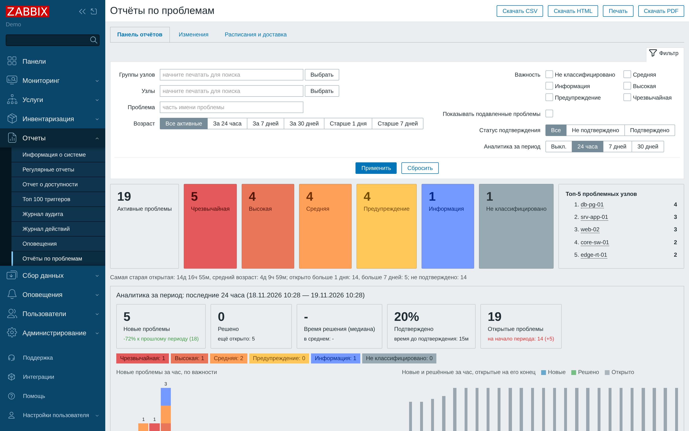
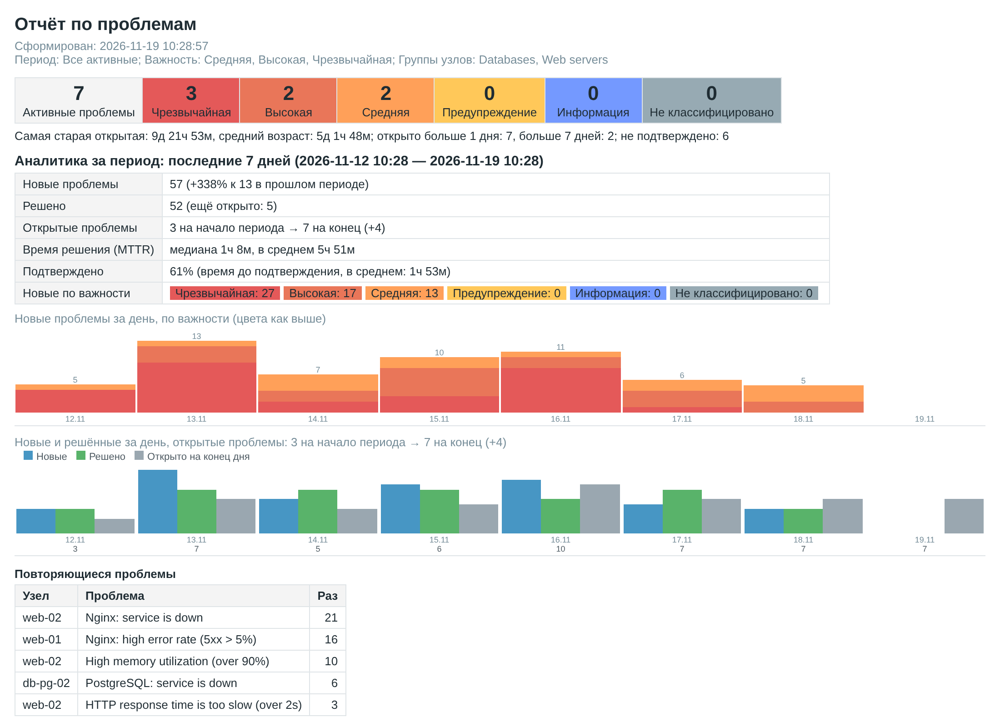
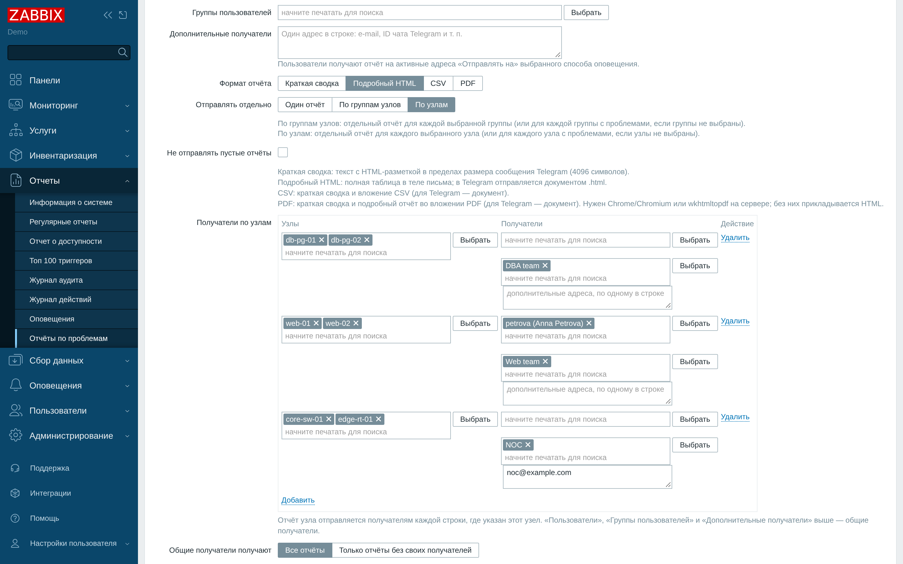
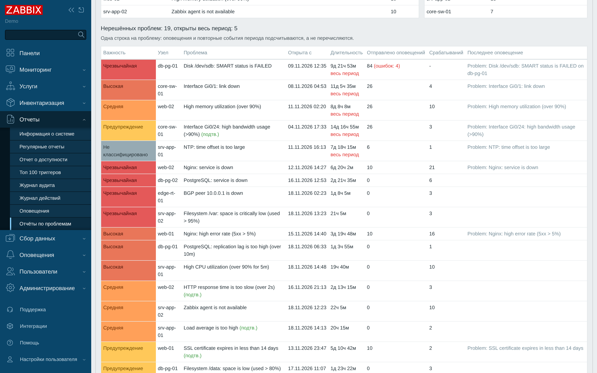
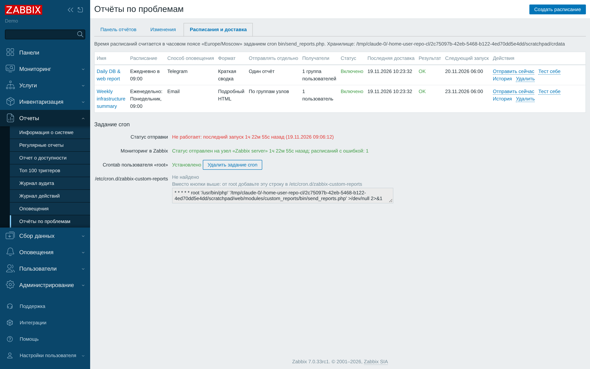

# Custom Problem Reports: модуль Zabbix 7.0 LTS

Модуль фронтенда (manifest v2.0) добавляет пункт **Отчёты → Отчёты по проблемам**
(в английском интерфейсе Zabbix — **Reports → …**).

Интерфейс модуля и сами отчёты (письма, PDF, CSV, сообщения Telegram) по умолчанию на **русском**;
язык задаётся параметром `language` в `conf/config.php` (см. [«Язык»](#язык)). Ниже названия вкладок
и полей даны так, как они выглядят в английском режиме (`'language' => 'en'`).

- **Вкладка «Report dashboard»**: фильтр (группы хостов, хосты, важность, возраст проблемы), KPI-карточки
  (всего активных проблем, разбивка по важности в цветах Zabbix, топ-5 хостов), таблица незакрытых проблем
  (время, длительность, важность, хост, проблема, подтверждение), выгрузка CSV / HTML / PDF / печать
  и тестовая отправка «Send now» на свои media.
- **Вкладка «Schedules and delivery»** (только Super admin): расписания рассылок (ежедневно или еженедельно
  в заданный день и время), фильтр отчёта, получатели (пользователи, группы пользователей, дополнительные адреса),
  media type (Email, Telegram webhook, Script), формат (краткая сводка, подробный HTML, CSV),
  разбивка: одним отчётом, **отдельно по группам хостов** или **отдельно по хостам**, опция «не отправлять пустые».
  Там же блок **Cron job**: статус рассыльщика и кнопка создания/удаления задания cron.
- **`bin/send_reports.php`**: CLI-рассыльщик для cron (раз в минуту).

## Скриншоты

Сняты на Zabbix 7.0.33 с тестовыми данными, язык модуля `ru` (по умолчанию).

| | |
|---|---|
|  |  |
| Панель отчётов: KPI, топ узлов, аналитика за период | Фильтр: группы Databases + Web servers, «Средняя» и выше |
|  |  |
| Расписания и блок «Задание cron» | Выгрузка HTML (то же уходит в письме) |
|  |  |
| Форма расписания: отправка по узлам, свои получатели | Отправка по группам узлов, свои получатели |
|  |  |
| Фильтр «nginx» + неподтверждённые, сортировка по времени, тестовая доставка себе | Те же фильтры и «Сортировка» в форме расписания |
|  |  |
| Аналитика за 7 дней, графики, повторяющиеся проблемы | Расписание: период аналитики (Авто / 24 часа / 7 / 30 дней), анализ изменений |
|  |  |
| Нерешённые проблемы: одна строка на проблему, оповещения за период, «весь период» | Расписание: «Только сводка нерешённых» вместо полного списка |
|  |  |
| Графики: новые по важности; новые / решённые / открытые на конец дня | Расписания: результат, следующий запуск, «Тест себе», «История», мониторинг в Zabbix |
|  |  |
| История доставки: запуски и результат по каждому получателю | Вкладка «Изменения»: было → стало, рост и снижение |
|  | |
| Новые и исчезнувшие проблемы, MTTR по важности, тепловая карта, «шумные» триггеры | |

Примеры отчётов: [docs/sample-report.pdf](docs/sample-report.pdf) (полный, с аналитикой и изменениями),
[docs/sample-report-summary.pdf](docs/sample-report-summary.pdf) (сводка нерешённых проблем).

## Дерево файлов

```
custom_reports/
├── manifest.json                     # manifest v2.0: действия, ассеты
├── Module.php                        # пункт меню Reports → Custom Problem Reports
├── actions/                          # контроллеры (CController)
│   ├── Dashboard.php                 # customreports.dashboard: фильтр, KPI, таблица
│   ├── Export.php                    # customreports.export: CSV / HTML / печать в PDF
│   ├── SendNow.php                   # customreports.send: тестовая отправка себе (POST + CSRF)
│   ├── ScheduleList.php              # customreports.schedule.list
│   ├── ScheduleEdit.php              # customreports.schedule.edit: форма
│   ├── ScheduleUpdate.php            # customreports.schedule.update: сохранение (POST + CSRF)
│   ├── ScheduleDelete.php            # customreports.schedule.delete (POST + CSRF)
│   ├── ScheduleRun.php               # customreports.schedule.run: «Send now» для расписания
│   ├── Changes.php                   # customreports.changes: вкладка «Changes» (сравнение периодов)
│   ├── ChangesExport.php             # customreports.changes.export: CSV / HTML / PDF / печать вкладки
│   ├── ScheduleTest.php              # customreports.schedule.test: «Test to me» — отчёт расписания только себе
│   ├── ScheduleHistory.php           # customreports.schedule.history: история доставок
│   └── CronUpdate.php                # customreports.cron.update: создать/удалить задание cron
├── views/
│   ├── customreports.dashboard.php
│   ├── customreports.schedule.list.php
│   ├── customreports.schedule.edit.php
│   ├── customreports.changes.php
│   ├── customreports.schedule.history.php
│   └── layout.customreports.download.php  # layout выгрузок: Content-Type/Disposition
├── lib/                              # общий код фронтенда и CLI
│   ├── ApiClientInterface.php
│   ├── ApiException.php
│   ├── FrontendApiClient.php         # API::Problem(), API::Trigger(), API::Host(), ... от имени пользователя
│   ├── JsonRpcApiClient.php          # api_jsonrpc.php + API token (CLI)
│   ├── ReportBuilder.php             # problem.get + trigger.get → агрегаты
│   ├── ReportSplitter.php            # разбивка отчёта по группам хостов / по хостам
│   ├── PeriodAnalytics.php           # аналитика за период из event.get: новые, MTTR, MTTA, по дням, повторы
│   ├── PdfConverter.php              # HTML → PDF через headless Chrome/Chromium или wkhtmltopdf
│   ├── ProcessRunner.php             # запуск внешних команд с таймаутом
│   ├── ReportRenderer.php            # CSV, HTML (inline-стили для почты), текст для Telegram
│   ├── RecipientResolver.php         # пользователи/группы → «Send to» выбранного media type
│   ├── Dispatcher.php                # выбор транспорта по media type
│   ├── ReportService.php
│   ├── ScheduleHelper.php            # нормализация, валидация, расчёт времени запуска
│   ├── ScheduleStorage.php           # schedules.json / state.json с flock и атомарной записью
│   ├── CronManager.php               # crontab пользователя веб-сервера, heartbeat, строка для /etc/cron.d
│   ├── ChangeAnalytics.php           # сравнение периода с предыдущим: все блоки вкладки «Changes»
│   ├── ChangeRenderer.php            # блоки «Changes» в HTML/PDF, CSV и тексте Telegram
│   ├── ZabbixStatus.php              # статус доставки → trapper-элементы Zabbix (history.push)
│   ├── DbSecretResolver.php          # пароль SMTP из БД (CLI), API его не отдаёт
│   ├── FrontendHelper.php            # фильтр в профиле пользователя, вкладки, media текущего пользователя
│   ├── I18n.php                      # перевод: словари lib/lang/<язык>.php, параметр language
│   ├── i18n_functions.php            # cr_t() / cr_s() / cr_n() для представлений и контроллеров
│   ├── lang/ru.php                   # русский словарь (английский текст => перевод, формы множественного числа)
│   ├── ModuleConfig.php, Logger.php, Period.php, Severity.php
│   └── transport/
│       ├── SmtpTransport.php         # SMTP: none / STARTTLS / SSL, AUTH LOGIN, вложения
│       ├── TelegramTransport.php     # Bot API: sendMessage (HTML) + sendDocument
│       └── ScriptTransport.php       # AlertScriptsPath/<exec_path> с параметрами media type
├── assets/
│   ├── css/customreports.css
│   └── js/customreports.js
├── bin/send_reports.php              # cron-рассыльщик
├── conf/config.example.php           # → conf/config.php
├── zabbix/zbx_template_custom_reports.yaml  # шаблон Zabbix: «рассылка не работает / доставка не удалась»
└── data/                             # хранилище по умолчанию (лучше вынести, см. ниже)
```

## Как это работает

**Права.** Дашборд и выгрузки строятся через `API::Problem()` / `API::Trigger()` в контексте текущего
пользователя, поэтому видны только проблемы хостов, к группам которых у пользователя есть доступ на чтение.
Доступ к модулю дополнительно ограничивается ролью пользователя (*Access to modules*). Тестовая отправка
доступна с типом пользователя Admin и выше, а только на свои active media. Управление расписаниями
доступно только Super admin. Все изменяющие действия принимают только POST с CSRF-токеном Zabbix.

**Рассылка.** Фронтенд-модули не умеют выполнять код по расписанию, поэтому `bin/send_reports.php`
запускается cron раз в минуту. Он берёт блокировку (два запуска одновременно не пойдут), читает
`schedules.json`, находит расписания, у которых последний плановый момент позже последнего запуска
и последнего редактирования (пропущенный запуск догоняется в течение `grace_period`), строит отчёт через
Zabbix API (JSON-RPC, API token) и отправляет его. Результат пишется в `state.json` (видно в списке
расписаний) и в лог.

**Media types:**

| Тип media type | Как отправляется | Откуда настройки |
|---|---|---|
| Email | собственный SMTP-клиент модуля | `smtp_server/port/helo/email/security/verify_*`, `username` из `mediatype.get`; пароль API не отдаёт: берётся из БД (`zabbix.conf.php`) или `smtp_passwords` в конфиге |
| Webhook Telegram | Telegram Bot API | параметр `Token`/`api_token` (и `HTTPProxy`/`api_proxy`) media type; chat ID из «Send to» пользователя. Webhook считается Telegram-ом, если его скрипт обращается к `api.telegram.org`, в названии есть «Telegram» или у него есть пара параметров токен + chat ID (`api_token`+`api_chat_id`, `Token`+`ChatID`); Slack, Mattermost и др. с параметром `token` не путаются |
| Script | `AlertScriptsPath/<exec_path>` | параметры media type, `{ALERT.SENDTO}`, `{ALERT.SUBJECT}`, `{ALERT.MESSAGE}` |
| Прочие webhook, SMS | не поддерживаются | JavaScript webhook-а исполняется только внутри Zabbix server |

**Фильтры и сортировка.** На дашборде и в расписаниях одинаковые условия отбора:

- *Host groups*, *Hosts*, *Severity*;
- *Age* — время возникновения: все активные, за последние 24 ч / 7 / 30 дней, старше 1 / 7 дней;
- *Problem* — часть названия проблемы (без учёта регистра, `problem.get` с `search`);
- *Acknowledgement status* — все / неподтверждённые / подтверждённые;
- *Show suppressed problems*.

Таблицу на дашборде можно сортировать кликом по заголовку колонки: Time, Duration, Severity, Host, Problem,
Ack (повторный клик меняет направление, выбор запоминается в профиле пользователя). Выгрузки CSV / HTML / PDF
идут с тем же фильтром и в том же порядке. В расписании порядок задаётся полем *Sort by* (+ по возрастанию /
по убыванию) и действует на все форматы. При равенстве значений проблемы упорядочены по важности, затем по времени.

**Разбивка (Send separately):**

- *One report*: один отчёт по всему фильтру.
- *Per host group*: отдельное сообщение на каждую выбранную в фильтре группу; если группы не выбраны, то на
  каждую группу, в которой есть проблемы. Группы хостов берутся через `host.get` с `selectHostGroups`.
- *Per host*: отдельное сообщение на каждый выбранный хост; если хосты не выбраны, то на каждый хост с проблемами.
- Проблема триггера с несколькими хостами (или хоста из нескольких групп) попадает во все подходящие части.
  Заголовок части: «<название> - <группа/хост>».
- *Do not send empty reports*: части без проблем не отправляются (без разбивки: не отправлять, если проблем нет).

Список проблем читается из API один раз и делится в памяти.

**Получатели по группам хостов и по хостам.** В форме расписания есть таблицы *Recipients per host group*
(видна при *Per host group*) и *Recipients per host* (видна при *Per host*). В каждой строке одна или несколько
групп хостов (или хостов) и свои получатели: пользователи, группы пользователей, дополнительные адреса.
Кнопки *Add* / *Remove* добавляют и удаляют строки. Используется только таблица текущего режима разбивки,
вторая сохраняется, но игнорируется.

- Отчёт группы (хоста) получают все строки, в которых эта группа (хост) выбрана. Пример для *Per host*:
  «db-01, db-02 → DBA», «web-01 → команда сайта».
- Обычные поля *Users*, *User groups*, *Additional recipients* — это общие получатели. Режим
  *Common recipients receive*:
  - *All reports*: общие получатели получают все отчёты, плюс каждый отчёт уходит своим получателям;
  - *Only reports without own recipients*: общие получатели получают только отчёты групп (хостов), для которых
    нет своей строки (получатели «по умолчанию»).
- Если для группы (хоста) нет строки и общих получателей нет, отчёт не отправляется (в логе: `skipped`).
  Если строка есть, но ни у кого из её получателей нет активного media выбранного типа, это ошибка доставки.
- Если в фильтре отчёта выбраны группы хостов (хосты), группы (хосты) в строках получателей должны быть среди них,
  иначе форма не сохранится. При пустом фильтре правила срабатывают для любых групп (хостов) с проблемами.
  При разбивке по хостам и фильтре только по группам хост из строки должен входить в эти группы, иначе отчёта
  по нему не будет.
- Способ доставки (media type) и формат у всех получателей одного расписания общие.

**Вкладка «Changes» — что изменилось за период.** Выбранный период сравнивается с предыдущим той же длины
(7 дней — с предыдущими 7 днями). Блоки не повторяют дашборд:

| Блок | Что показывает |
|---|---|
| Было → стало | по группам хостов / хостам / триггерам: новые проблемы и медиана времени решения, раньше и сейчас, изменение ▲▼ |
| Biggest growth / decline | топ-5 с наибольшим ростом и снижением числа проблем |
| New / disappeared problems | триггеры, сработавшие впервые (в прошлом периоде их не было), и те, что перестали срабатывать (и сейчас не открыты) |
| MTTR by severity | медиана времени решения по каждому уровню важности, раньше и сейчас |
| When problems start | тепловая карта «день недели × час» по новым проблемам периода |
| Noisy triggers | частые и короткоживущие (решены быстрее 5 минут) проблемы — кандидаты на настройку порогов и гистерезиса |
| Time in problem | время, когда у группы (или хоста) была открыта хотя бы одна проблема High/Disaster, пересечения считаются один раз; в % периода |

Фильтры: группы хостов, хосты, важность, часть названия проблемы, период (24 ч / 7 / 30 дней или произвольные
даты с календарём, до 92 дней), группировка таблиц (группы хостов / хосты / триггеры). Фильтр запоминается.
Экспорт: CSV (по разделам), HTML, PDF, печать. В расписании флажок **Changes analysis** добавляет эти блоки в
HTML/PDF-отчёт и несколько строк в краткую сводку (при разбивке — для каждой части свои).

**Статус и проверка доставки.** На вкладке *Schedules and delivery*:

- *Last delivery* / *Result* — время и итог последней доставки (по расписанию или «Send now»):
  **OK** (всё доставлено), **Partially** (часть получателей не получила), **Error** (никто не получил или запуск
  не состоялся: нет получателей, отключён media type, ошибка API), **Nothing to send** (проблем по фильтру нет).
  По клику — краткая причина. *Next run* — когда расписание сработает в следующий раз.
- **Test to me** — тот же отчёт со всеми настройками расписания (фильтр, формат, разбивка, аналитика), но только
  на ваш собственный адрес этого способа доставки (User settings → Profile → Media). Остальным получателям ничего
  не уходит, статус расписания не меняется.
- **History** — последние 50 запусков (по расписанию, «Send now», «Test to me», кто запускал), по каждому
  запуску — результат по каждому получателю и части отчёта с текстом ошибки (*Details*).
- «OK» означает, что почтовый сервер или Telegram приняли сообщение. Если письмо позже вернётся (bounce), модуль
  об этом не узнает.

**Мониторинг рассылки самим Zabbix.** Если задать `zabbix_status_host`, cron-рассыльщик при каждом запуске
отправляет статус (API `history.push`, Zabbix 7.0) в trapper-элементы шаблона
[zabbix/zbx_template_custom_reports.yaml](zabbix/zbx_template_custom_reports.yaml):

| Элемент | Значение | Триггер |
|---|---|---|
| `custom_reports.heartbeat` | время последнего запуска рассыльщика | *Report sender (cron) is not running* (Average): нет данных `{$CUSTOM_REPORTS.NODATA}` (10m) |
| `custom_reports.failed` | число включённых расписаний, последняя доставка которых не удалась (Error или Partially) | *Scheduled report delivery failed: N schedule(s)* (High), в оперативных данных — ошибки |
| `custom_reports.last_error` | строки «расписание: ошибка» | |

Проблема закрывается сама после следующей успешной доставки. Состояние отправки статуса видно в блоке *Cron job*
(строка *Zabbix monitoring*).

**Форматы:**

- *Short summary*: текст с HTML-разметкой Telegram, обрезается до 4096 символов («... and N more»).
  Для Email отправляется как текст (или HTML, если в media type выбран HTML).
- *Detailed HTML*: таблица в теле письма; в Telegram сводка + документ `.html`.
- *CSV*: сводка + вложение `.csv` (в Telegram документом). Ячейки, начинающиеся с `=`, `+`, `-`, `@`, получают
  префикс `'`, чтобы Excel/LibreOffice не выполнили их как формулу (защита от CSV-инъекции).
- *PDF*: сводка + подробный отчёт вложением `.pdf` (A4, альбомная; в Telegram документом). PDF рендерит
  headless Chrome/Chromium, запасной вариант — `wkhtmltopdf`. Если ни одного нет, вкладывается HTML,
  а в лог пишется предупреждение. Пример: [docs/sample-report.pdf](docs/sample-report.pdf).

**Аналитика за период (Period analytics).** Кроме списка открытых проблем отчёт показывает, что происходило
за период: 24 часа, 7 или 30 дней (в расписании *Auto*: 24 часа для ежедневного, 7 дней для еженедельного).
Данные берутся из истории событий (`event.get`) с теми же фильтрами по группам, хостам, важности и названию:

| Показатель | Что это |
|---|---|
| New problems | сколько проблем возникло за период, и изменение в % к предыдущему такому же периоду |
| New by severity | новые проблемы по уровням важности |
| Resolved / still open | сколько из них уже закрыто и сколько ещё открыто |
| MTTR | время до закрытия: медиана и среднее |
| Acknowledged / MTTA | доля подтверждённых и среднее время до подтверждения |
| Open problems | сколько проблем было открыто в начале периода и сколько в конце (с разницей) |
| График 1 | новые проблемы по дням (по часам для 24 ч), столбики разбиты по важности — растёт ли именно критичное |
| График 2 | по дням: новые / решённые / открытые на конец дня — успевают ли закрывать проблемы быстрее, чем появляются новые |
| Recurring problems | триггеры, сработавшие за период больше одного раза (топ-5) |
| Unresolved problems | нерешённые проблемы одной строкой каждая, с числом алертов за период (см. ниже) |
| Hosts with most new problems | топ-5 хостов по числу новых проблем |

Для открытых проблем добавлена строка: самая старая и средняя длительность, сколько открыто дольше 1 и 7 дней,
сколько не подтверждено.

**Нерешённые проблемы (Unresolved problems).** Отдельный раздел (при включённой аналитике) про проблемы, которые
так и не решены: **одна строка на проблему (триггер)**, без повторов, даже если за неделю по ней ушло 100 алертов:

| Колонка | Что это |
|---|---|
| Open since / Duration | с какого момента открыта и сколько; **whole period** — была открыта весь период отчёта |
| Alerts sent | сколько уведомлений по ней отправлено за период (`alert.get`), отдельно — сколько не доставлено |
| Fired | сколько раз триггер срабатывал за период (повторные события) |
| Last alert | тема последнего отправленного алерта — краткое описание, как его видели получатели |

Сначала идут проблемы, открытые весь период (например, диск, который за неделю так и не заменили), затем по
важности и длительности. Опция расписания **Problem list → Unresolved summary only** убирает из отчёта полный
список открытых проблем, оставляя только этот сгруппированный раздел (в Telegram — по строке на проблему).
Пример: [docs/sample-report-summary.pdf](docs/sample-report-summary.pdf). Если у пользователя API-токена нет прав
на `alert.get`, счётчики алертов показываются как «-», остальное работает. При разбивке по группам/хостам аналитика считается отдельно для каждой части.
Если историю событий прочитать нельзя (нет прав), отчёт уходит без аналитики с пометкой об этом. На дашборде по умолчанию
выбран период 24 часа (аналитика за 7/30 дней читает заметно больше истории); выбор запоминается.

Графики собраны из ячеек таблицы и блоков фиксированной высоты, без картинок и SVG: так они одинаково выглядят
в почтовых клиентах (включая Outlook), в PDF и на дашборде. Шкала у столбиков второго графика общая, поэтому
их можно сравнивать между собой. Открытые на конец каждого дня считаются точно: модуль берёт все проблемы,
активные в течение периода (`event.get` с `problem_time_from` / `problem_time_till`), включая начавшиеся раньше.
При 30 днях подписана каждая вторая дата (полная дата — во всплывающей подсказке на дашборде). В Telegram
вместо графиков две строки-«спарклайна»: новые по дням и открытые на конец дня.
Чтение ограничено `analytics_limit` событиями за период (по умолчанию 10 000).

## Установка

Пути ниже даны для пакетной установки на Debian/Ubuntu (фронтенд в `/usr/share/zabbix`, PHP-FPM или Apache
от `www-data`). На RHEL-подобных системах пользователь веб-сервера `apache` или `nginx`.

1. Скопируйте модуль:

   ```bash
   cp -r custom_reports /usr/share/zabbix/modules/
   ```

2. Выставьте владельца и права (код читает веб-сервер, писать он может только в каталог данных):

   ```bash
   chown -R root:www-data /usr/share/zabbix/modules/custom_reports
   ```

   ```bash
   find /usr/share/zabbix/modules/custom_reports -type d -exec chmod 755 {} \; -o -type f -exec chmod 644 {} \;
   ```

   ```bash
   chmod 755 /usr/share/zabbix/modules/custom_reports/bin/send_reports.php
   ```

3. Создайте каталог данных вне webroot:

   ```bash
   install -d -o www-data -g www-data -m 750 /var/lib/zabbix-custom-reports
   ```

4. Создайте API token: *Users → API tokens → Create API token* для пользователя типа **Super admin**
   (нужен для `user.get` с media, `usergroup.get`, `mediatype.get`). Содержимое отчётов по расписанию
   ограничено правами этого пользователя. Если хотите, чтобы отчёт видел только часть хостов, заведите
   отдельного пользователя под рассылку.

5. Настройте конфиг:

   ```bash
   cp /usr/share/zabbix/modules/custom_reports/conf/config.example.php /usr/share/zabbix/modules/custom_reports/conf/config.php
   ```

   ```bash
   chown root:www-data /usr/share/zabbix/modules/custom_reports/conf/config.php && chmod 640 /usr/share/zabbix/modules/custom_reports/conf/config.php
   ```

   Заполните `api_url`, `api_token`, `timezone` (например, `Europe/Moscow`), `frontend_url`
   и при необходимости `language` (`ru` по умолчанию, `en` или `auto`, см. [«Язык»](#язык)).
   `timezone` задайте обязательно: у веб-интерфейса и у cron разные часовые пояса PHP по умолчанию (фронтенд
   переключается на пояс пользователя). Без него время расписаний считается в UTC, а на вкладке расписаний
   показывается предупреждение; неверное значение останавливает рассылку с ошибкой в логе.
   Для чтения SMTP-пароля из БД пользователь cron должен иметь право читать
   `/etc/zabbix/web/zabbix.conf.php` (в пакетах он и так принадлежит `www-data`). Иначе задайте
   `smtp_passwords` или выключите `db_fallback`.

6. Если используется nginx и вы оставили каталог данных по умолчанию (`modules/custom_reports/data`),
   закройте его, `.htaccess` действует только в Apache:

   ```nginx
   location ~ ^/modules/custom_reports/(data|conf|bin)/ { deny all; }
   ```

7. Активируйте модуль: *Administration → General → Modules → Scan directory*, затем у строки
   «Custom Problem Reports» нажмите *Disabled* → *Enabled*. Проверьте, что в *Users → User roles* у нужных
   ролей разрешён доступ к модулю. Пункт появится в *Reports → Custom Problem Reports*.

8. Для отчётов в PDF установите headless-браузер (если на сервере уже работает `zabbix_web_service` для штатных
   отчётов Zabbix, он, как правило, уже есть). Debian/Ubuntu:

   ```bash
   apt install chromium
   ```

   RHEL/Rocky/Alma (EPEL): `dnf install chromium-headless`, или Google Chrome из репозитория Google.
   Путь находится автоматически (`/usr/bin/chromium`, `/usr/bin/google-chrome` и др.); иначе задайте
   `chrome_binary` в `conf/config.php`. Вместо браузера можно поставить `wkhtmltopdf`.

9. Проверьте рассыльщик вручную от пользователя веб-сервера:

   ```bash
   sudo -u www-data php /usr/share/zabbix/modules/custom_reports/bin/send_reports.php --list
   ```

   ```bash
   sudo -u www-data php /usr/share/zabbix/modules/custom_reports/bin/send_reports.php --run=<scheduleid> -v
   ```

   `scheduleid` видно в `--list`. Опция `--dry-run` показывает, что было бы отправлено сейчас.

10. Создайте задание cron. Есть два способа, нужен один.

   **Из интерфейса модуля:** *Reports → Custom Problem Reports → Schedules and delivery*, блок **Cron job**,
   кнопка **Create cron job**. Модуль добавит строку с меткой `# zabbix-custom-reports` в crontab пользователя
   веб-сервера (`crontab -l` / `crontab -`), не трогая остальные строки. Кнопка **Remove cron job** её удаляет.
   Условия: установлен `cron`, пользователь веб-сервера не запрещён в `/etc/cron.deny`, `proc_open` не в
   `disable_functions`. На RHEL с SELinux httpd по умолчанию не может запускать `crontab`, там используйте
   второй способ. Путь к PHP CLI определяется автоматически (`/usr/bin/php`), при необходимости задайте
   `php_binary` в конфиге.

   **Вручную через `/etc/cron.d`** (от root). Готовая строка с вашими путями показана в том же блоке:

   ```bash
   echo '* * * * * www-data /usr/bin/php /usr/share/zabbix/modules/custom_reports/bin/send_reports.php >/dev/null 2>&1' > /etc/cron.d/zabbix-custom-reports
   ```

   В блоке **Cron job** видно, работает ли рассыльщик: при каждом плановом запуске он пишет
   `heartbeat.json` в каталог данных. Если запусков нет больше 3 минут, статус станет красным. Если задание
   есть в обоих местах, модуль предупредит; дублей отправки не будет (блокировка и учёт времени последнего
   запуска), но одну запись лучше удалить. Запускайте от того же пользователя, что и веб-сервер.

11. (Рекомендуется) Мониторинг рассылки в Zabbix: *Data collection → Templates → Import* —
    `zabbix/zbx_template_custom_reports.yaml`; привяжите шаблон к хосту (например, «Zabbix server») и укажите его
    техническое имя в `conf/config.php`: `'zabbix_status_host' => 'Zabbix server'`. Пользователю API-токена нужны
    права на запись на этот хост. Через минуту в блоке *Cron job* появится «Status sent to host …», а в
    *Monitoring → Latest data* — значения `custom_reports.*`.

12. Лог: `/var/lib/zabbix-custom-reports/logs/custom_reports.log`. Ротация:

    ```bash
    printf '%s\n' '/var/lib/zabbix-custom-reports/logs/*.log {' '  weekly' '  rotate 8' '  compress' '  missingok' '  notifempty' '  su www-data www-data' '}' > /etc/logrotate.d/zabbix-custom-reports
    ```

Коды возврата `send_reports.php`: 0 — успех, 1 — часть отправок не прошла, 2 — ошибка конфигурации,
3 — предыдущий запуск ещё работает.

## Язык

Параметр `language` в `conf/config.php`:

| Значение | Веб-интерфейс модуля | Отчёты по расписанию (cron) |
|---|---|---|
| `ru` (по умолчанию) | русский | русский |
| `en` | английский | английский |
| `auto` | язык пользователя Zabbix (русский для `ru_RU`, иначе английский) | английский |

Переводится всё, что выводит модуль: вкладки, фильтры, формы, сообщения и ошибки, история доставок, а также
содержимое отчётов: тема письма, HTML/PDF, заголовки CSV, краткая сводка для Telegram, блоки «Изменения»,
единицы длительности (`2д 5ч 10м`). Стандартные названия уровней важности переводятся
(Disaster → Чрезвычайная и т.д.); если в *Администрирование → Общие → Опции отображения триггеров* заданы свои
названия, они выводятся как есть. Технические сообщения в логе cron остаются на английском.

Элементы самого Zabbix на страницах модуля (главное меню, кнопки «Применить/Сбросить» фильтра, поле выбора
групп и узлов) следуют языку пользователя Zabbix (*Настройки пользователя → Профиль → Язык*). Чтобы русский
был доступен там, на сервере фронтенда должна быть локаль `ru_RU.UTF-8` (`locale-gen ru_RU.UTF-8`).

Перевод хранится в `lib/lang/ru.php` (английский исходный текст => перевод). Чтобы поправить формулировку,
измените значение в этом файле; чтобы добавить язык, создайте `lib/lang/<код>.php` с тем же форматом и
разрешите код в `I18n::lang()`. Строки, которых нет в словаре, выводятся через перевод Zabbix (gettext),
а если его нет, по-английски.

## Ограничения

- Webhook-и, кроме Telegram (Slack, Teams и т.п.), не поддерживаются: их JavaScript выполняется только
  Zabbix server-ом. Для них используйте Email или Script.
- Фильтр по группе хостов не включает подгруппы (так работает `problem.get`): выбирайте подгруппы явно.
- В отчёт попадает не больше `problem_limit` проблем (на дашборде не больше *Search/Filter elements limit*);
  при обрезке это отмечается в отчёте.
- Серверный PDF требует Chrome/Chromium или `wkhtmltopdf` на сервере фронтенда (для кнопки *Download PDF*)
  и на машине, где работает cron (для рассылки). Кнопка *Print* работает без них: открывает HTML-отчёт и печать
  браузера («Сохранить как PDF»).
- Аналитика за период считает события из истории Zabbix: если housekeeper уже удалил события старше
  срока хранения (*Administration → Housekeeping → Events and alerts*), их не будет и в отчёте.
