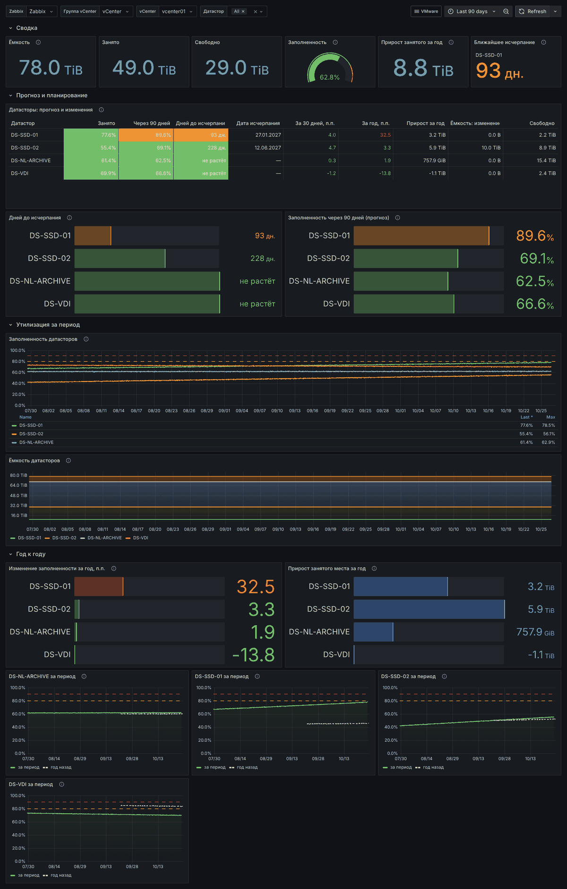
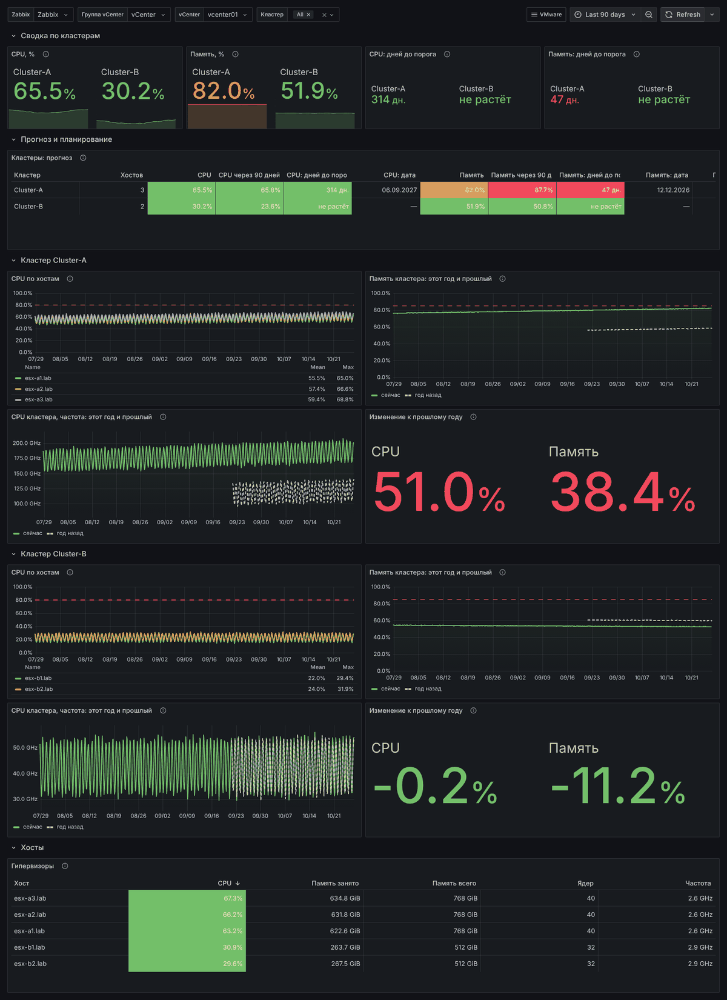
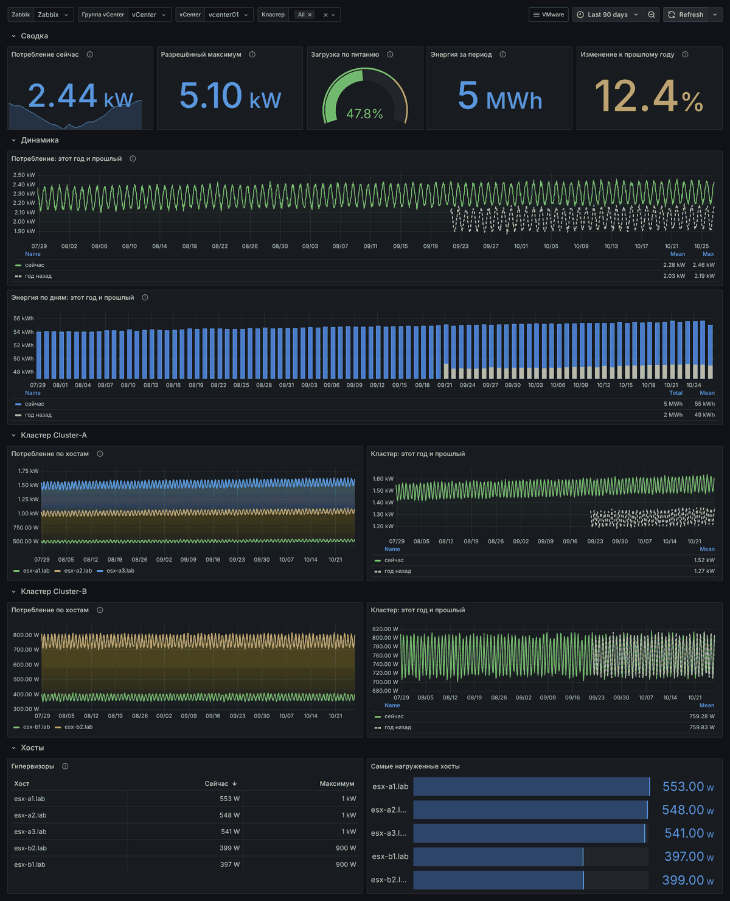

# VMware vCenter: аналитика ёмкости в Grafana

Три дашборда Grafana и дополнительный шаблон Zabbix, который считает прогнозы
и изменения «год к году» по данным стандартного шаблона **VMware**.

| Файл | Что это |
|---|---|
| `zbx_template_vmware_capacity.yaml` | шаблон Zabbix 7.0 **VMware capacity planning** (вычисляемые элементы, LLD, триггеры) |
| `grafana/vmware-datastores.json` | дашборд «VMware — датасторы» |
| `grafana/vmware-cpu-memory.json` | дашборд «VMware — CPU и память» |
| `grafana/vmware-power.json` | дашборд «VMware — питание» (кВт, кВт·ч) |
| `tools/gen_capacity_template.py`, `tools/gen_grafana_dashboards.py` | генераторы; файлы выше не правятся руками |
| `nsx/` | отдельный шаблон **VMware NSX by HTTP** (NSX-T / NSX 4.x через REST API), см. [nsx/README.md](nsx/README.md) |

## Что показывают дашборды

| Тема | Утилизация | Изменения за год | Прогноз и окончание ресурса |
|---|---|---|---|
| **Датасторы** | заполненность и ёмкость каждого датастора за выбранный период | прирост занятого места (байты и п.п.), изменение ёмкости, выбранный период и тот же период год назад на одном графике | дней до порога свободного места, дата исчерпания, заполненность через 90 дней |
| **CPU и RAM** | CPU по хостам, память кластера, таблица гипервизоров | изменение к прошлому году, линии прошлого года пунктиром | дней до порога CPU/памяти, дата, значение через 90 дней |
| **Питание** | потребление сейчас / по хостам / по кластерам, загрузка от разрешённого максимума | энергия по дням и потребление в сравнении с прошлым годом, изменение в % | не нужен |

**Период** выбирается обычным селектором времени Grafana (по умолчанию 90 дней).
Все графики «… за период» строятся за выбранный период; пунктиром — тот же период
год назад. Плитки текущего состояния и прогнозы всегда показывают последнее значение
(последние 24 ч), а «изменение за год» — разницу с той же датой год назад.





## Установка

1. **Шаблон.** *Data collection → Templates → Import* →
   `zbx_template_vmware_capacity.yaml`. Привяжите **VMware capacity planning**
   к хосту vCenter **вместе** со стандартным шаблоном **VMware** (берутся его
   макросы `{$VMWARE.URL}`, `{$VMWARE.USERNAME}`, `{$VMWARE.PASSWORD}` и элементы
   гипервизоров из групп `<кластер> (hypervisor)`).
2. **Тренды дольше года.** Стандартные шаблоны VMware хранят тренды 365 дней,
   а сравнению с прошлым годом нужно больше: *Administration → Housekeeping →
   Trends → Override item trend period* = `800d`. Элементы этого шаблона уже
   хранят тренды 730 дней. До накопления истории за год панели «год к году»
   пустые или неполные — это ожидаемо.
3. **Grafana.** Нужен плагин Zabbix (`alexanderzobnin-zabbix-app`) и источник
   данных Zabbix. *Dashboards → New → Import* → JSON-файл → выбрать источник.
   Переменная «Группа vCenter» по умолчанию выбирает группу хостов `vCenter`
   (если такой нет — первую по алфавиту); группы, которые VMware создаёт для
   обнаруженных хостов (`… (hypervisor)`, `… (vm)`), а также `Discovered hosts` и
   `Templates…` в списке скрыты. Свой выбор можно сохранить в дашборде (*Save dashboard*).
   Дашборды связаны между собой выпадающим меню «VMware» (теги `vmware`, `capacity`).

## Как считаются прогнозы

- Линейная регрессия по последним `{$VMW.FORECAST.PERIOD}` (30 дней):
  `timeleft()` — сколько дней до порога, `forecast()` — значение через
  `{$VMW.FORECAST.HORIZON}` (90 дней).
- Значения «дней до порога»: `0` — порог уже пройден; `-1` — мало данных
  (первые `{$VMW.FORECAST.MIN.HISTORY}` = 7 дней, на дашборде «мало данных»);
  `3650` (`{$VMW.FORECAST.MAX.DAYS}`) — ресурс не растёт или кончится не
  раньше чем через 10 лет («не растёт»).
- Кластерные элементы суммируют/усредняют элементы гипервизоров через
  `*_foreach`, поэтому прогноз по новому кластеру появится через 7 дней.
- Изменение за год = среднее за последние сутки минус среднее за те же сутки
  год назад (`trendavg(...,1d:now/d-1y)`).

## Макросы

| Макрос | По умолчанию | Назначение |
|---|---|---|
| `{$VMW.DS.PFREE.MIN}` | 10 | свободное место датастора, %, которое считается исчерпанием |
| `{$VMW.CL.CPU.MAX}` | 80 | загрузка CPU кластера, %, считается исчерпанием |
| `{$VMW.CL.MEM.MAX}` | 85 | загрузка памяти кластера, %, считается исчерпанием |
| `{$VMW.FORECAST.CRIT}` | 30 | триггер High, если ресурс кончится раньше, дней |
| `{$VMW.FORECAST.WARN}` | 90 | триггер Warning, дней (зависит от High) |
| `{$VMW.FORECAST.PERIOD}` | 30d | окно истории для регрессии |
| `{$VMW.FORECAST.HORIZON}` | 90d | горизонт элементов «at forecast horizon» |
| `{$VMW.FORECAST.MIN.HISTORY}` | 7d | минимум истории до первого прогноза |
| `{$VMW.FORECAST.MAX.DAYS}` | 3650 | значение «не растёт» |

Триггеры восстанавливаются с гистерезисом (> порога × 1,2) и игнорируют `-1`.

## Ограничения плагина Zabbix для Grafana (проверено на 4.6.0 + Zabbix 7.0)

- Выражения Grafana (*Expressions*) не используются: плагин 4.6 не
  подставляет переменные дашборда в запросы, отправленные вместе с
  выражениями. Все вычисления сделаны преобразованиями (*Transformations*).
- *Save & test* источника может показывать ошибку `apiinfo.version` при
  рабочем подключении, а при первой загрузке дашборда изредка бывает
  «Invalid version» — помогает обновление страницы. Переменные обновляются
  при каждой загрузке дашборда.

## Проверка

Формулы шаблона сверены с независимым расчётом на тестовом Zabbix 7.0 c
синтетической историей за 400 дней (82 проверки), все запросы дашбордов
возвращают данные, скриншоты выше сняты с этого стенда (данные
синтетические). Структуру шаблона и дашбордов проверяет
`tests/test_vmware.py`.

Перегенерация после изменений генераторов:

```bash
python3 vmware/tools/gen_capacity_template.py vmware/zbx_template_vmware_capacity.yaml
python3 vmware/tools/gen_grafana_dashboards.py vmware/grafana
```
